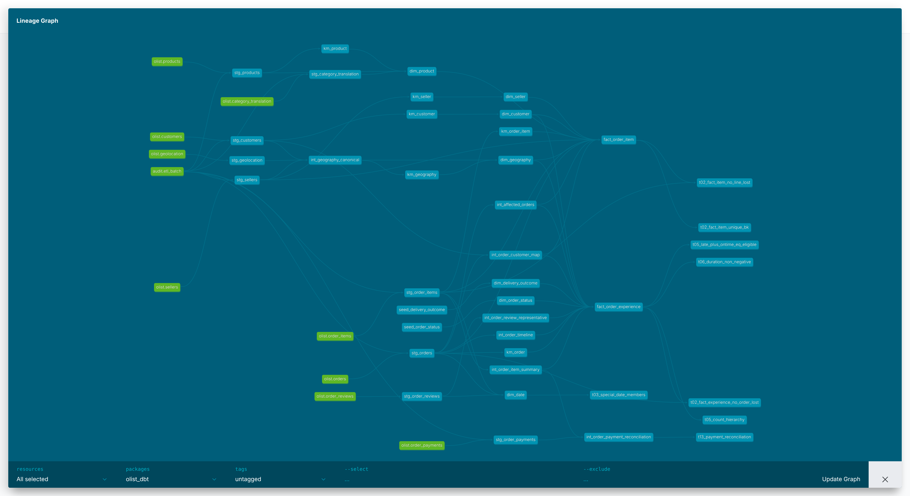

# Task 4 (Mini): tiến độ phần "Làm được ngay"

Nhánh `ssis/t4-tang-them`. Cập nhật 18/11.

## 1. Mô tả dbt docs: xong

- Thêm `description` cho **cả 31 model** (staging 9, intermediate 7, bảng khoá `km_*` 6, dim/fact 9) và các cột chính trong 4 file `olist_dbt/models/**/schema.yml`.
- Chỉ thêm mô tả; **không đổi test nào** (đã so từng test với bản trên `main` bằng script).
- Kiểm tra trên bản DuckDB hiện tại: nạp `FULL_001` bằng `olist_bi/custom/ingest_csv.py`, rồi:
  - `dbt build`: `PASS=162 WARN=1 ERROR=0 SKIP=0 TOTAL=163`, khớp số đối chiếu (cảnh báo là test T13 có chủ đích).
  - `dbt docs generate --static`: tạo `olist_dbt/target/static_index.html`, mở thẳng bằng trình duyệt, không cần server. Thư mục `target/` không commit.
- Số dòng staging sau `FULL_001`: orders 99.441; customers 99.441; order_items 112.650; order_reviews 99.224; order_payments 103.886; products 32.951; sellers 3.095; geolocation 1.000.163; category_translation 71.

Đồ thị lineage (nguồn → staging → intermediate/khoá → dim/fact → test):



Tạo lại:

```bash
cd olist_dbt && dbt build --profiles-dir . && dbt docs generate --profiles-dir . --static
```

## 2. Batch mô phỏng FULL_001, INC_001, INC_002: chờ script

- `make_asof_batches.py` **chưa có trên thư mục Drive** "Chuyen SSIS - phan cong task (17-11)" (ngày 18/11 mới có 4 file Task1–Task4).
- Không viết lại script mới, vì danh sách giả định mô phỏng ở đầu file gốc phải ghi vào báo cáo.
- `data/batches/` đã có sẵn trong `.gitignore`.
- Khi có script: đưa vào `scripts/`, rồi chạy lệnh dưới đây và điền bảng số dòng.

```bash
python scripts/make_asof_batches.py --raw data/raw --out data/batches --cutoffs "2017-12-31 23:59:59" "2018-04-30 23:59:59"
```

| Bảng | FULL_001 | INC_001 | INC_002 |
|---|---|---|---|
| orders | cần chạy | cần chạy | cần chạy |
| … (9 bảng) | | | |
